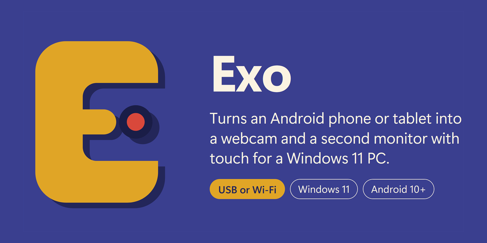
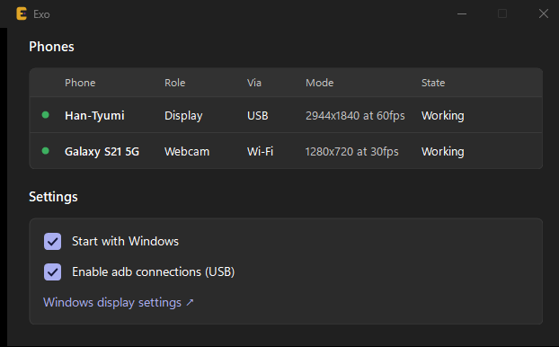
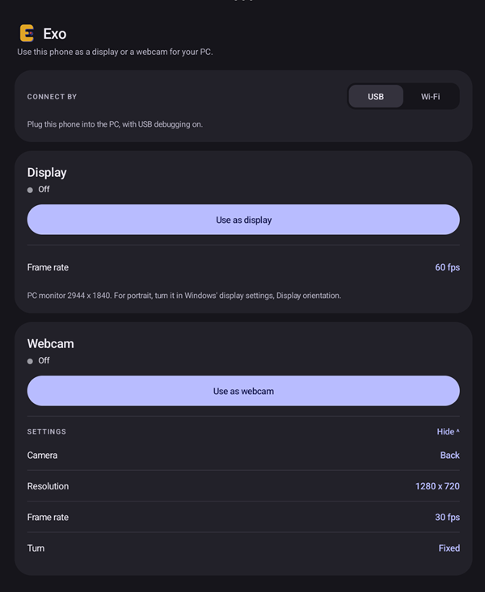

<h1 align="center">Exo</h1>

Plug it in by USB or join the same Wi-Fi, and the phone becomes a camera any app can pick, a touch screen beside your desktop, or both.

- [What is Exo?](#what-is-exo)
- [Why Exo](#why-exo)
- [Features](#features)
- [Getting started](#getting-started)
- [Docs](#docs)
- [Disclaimer](#disclaimer)
- [License](#license)

## What is Exo?

Exo turns an Android phone or tablet into a webcam and a second monitor
with touch for a Windows 11 PC.

Install Exo on the PC and the phone, open it on the phone, and tap
**Use as display** or **Use as webcam**. As a display, the phone shows
part of your desktop at its own resolution, and touching it works like
touching the PC's screen. As a webcam, the phone's camera shows up as
**Exo Camera** in Teams, Zoom, the Camera app or anything else that uses a
camera. One phone can do both, or two phones can take one role each.

## Why Exo

I'd wanted an open-source alternative to SuperDisplay for a while. I'd
also built a prototype that turned an Android phone into a webcam, but
it clashed with my SuperDisplay setup: each wanted its own adb server,
and they kept fighting over it.

So I combined the two ideas: recreate SuperDisplay, and extend it with
the webcam. Exo runs both roles through one adb, so there's nothing to
conflict with.

I also had a lot of spare Android devices lying around, and it seemed a
waste not to use their cameras.

And I wanted to see what Claude Opus 5.5 could do building an app from
scratch: a Windows display driver, a virtual camera, a PC app and an
Android app.

<table align="center">
  <tr>
    <th>Windows</th>
    <th>Android</th>
  </tr>
  <tr>
    <td valign="top"></td>
    <td valign="top"></td>
  </tr>
</table>

## Features

- **A webcam any Windows app can pick.** The phone's front or back
  camera, at 1920x1080, 1280x720 or 640x360, 30fps (60 where the camera
  offers it). Choose the lens, turn on the torch, and set zoom, exposure
  and focus live. The picture stays upright whichever way the phone
  lies.
- **A second monitor with touch,** at the phone's own resolution, 30 or
  60fps, about a tenth of a second behind the PC. Touch acts as touch on
  that part of the desktop. Landscape or portrait.
- **USB or Wi-Fi.** USB uses USB debugging. Over Wi-Fi the phone pairs
  once with a 6-digit code shown on both screens, and everything after
  that is encrypted.
- **One phone or two.** One phone can be both the webcam and the
  monitor, or two phones can take one role each.
- **Settings live on the phone.** The PC app sits in the tray, starts
  with Windows, and shows each phone with its role and state.
- **Free and open source,** under the MIT License.

## Getting started

You need a 64-bit **Windows 11** PC, an Android phone or tablet with
**Android 10** or later, and a USB cable or the same Wi-Fi network for
both.

1. Download `Exo-<version>-setup.exe` and `Exo-<version>.apk` from the
   [latest release](https://github.com/hiidz/exo/releases/latest).
2. Run the setup on the PC. Windows warns that it protected your PC:
   click **More info**, then **Run anyway**.
3. Install the APK on the phone.
4. For USB, turn on USB debugging on the phone and plug it in.
5. Open **Exo** on the phone, pick **USB** or **Wi-Fi**, and tap **Use
   as display** or **Use as webcam**.

Each step in full, including the Samsung and Smart App Control catches,
is in [Install](docs/install.md).

## Docs

- [Install](docs/install.md): what you need, installing on the PC and
  the phone, USB debugging, updating and uninstalling
- [Usage](docs/usage.md): connecting, roles, settings, the PC window,
  and what you will notice
- [Building](docs/building.md): how it works, and building it from
  source

## Disclaimer

**Exo is not code-signed.** Windows warns when you run the setup, and
with Smart App Control on, Windows blocks Exo outright. To load its
display driver, the setup adds Exo's own certificate, **Exo Release**,
to the certificates Windows trusts; uninstalling removes it.

Exo is not affiliated with SuperDisplay.

Exo was built from scratch with Claude Opus 5.5. I reviewed, tested and
run every change myself, but read the code with that in mind.

## License

[MIT](LICENSE). The display driver is under the Microsoft Public License
([`src/ExoDisplay/LICENSE`](src/ExoDisplay/LICENSE)). adb, shipped with
the installer, is under the Apache License 2.0. Their notices, and those
of Vortice and the .NET runtime, are installed in
`C:\Program Files\Exo\licenses`.
